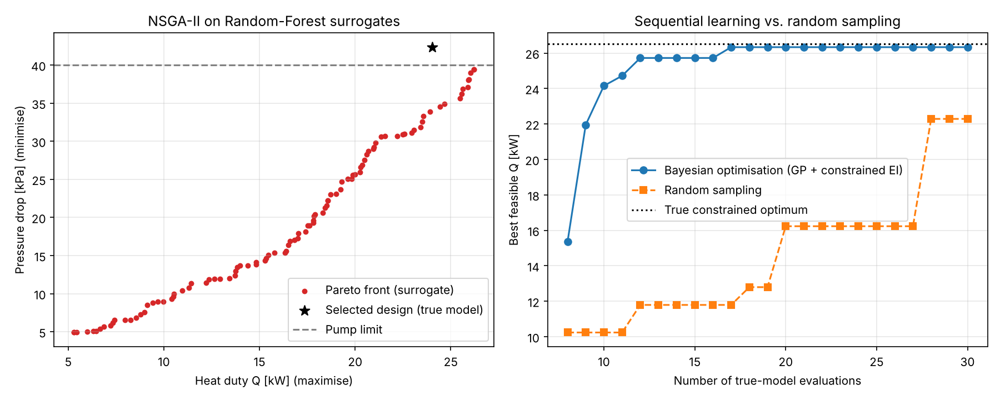

# Surrogate-Assisted Multi-Objective Optimisation and Sequential Learning for a Heat Exchanger

This project compares two ways of optimising an "expensive" engineering model with few evaluations:

1. **Surrogate + evolutionary optimisation**: Random-Forest surrogates are trained on a 1,000-point design of experiments (DoE), then **NSGA-II** (`pymoo`) searches the trade-off between heat duty and pressure drop, subject to a pump limit.
2. **Sequential learning (Bayesian optimisation)**: Gaussian-process surrogates and a **constrained Expected-Improvement** acquisition function choose each new evaluation one at a time.

## Model
The "expensive" model stands in for a CFD run. It is a tube heat exchanger with a constant wall temperature.
- Heat duty: ε-NTU method, with h ∝ ṁ^0.8 (Dittus–Boelter scaling)
- Pressure drop: Blasius-type, ΔP ∝ L · ṁ^1.75
- Design variables: mass flow rate (0.1–0.5 kg/s), inlet temperature (60–100 °C), tube length (1–5 m)
- Constraint: ΔP ≤ 40 kPa

## Results (seed 42)
| Method | True-model evaluations | Best feasible Q |
|---|---|---|
| NSGA-II on Random-Forest surrogates | 1,000 (training) | 24.0 kW, **violates** ΔP limit (42.4 kPa) |
| Bayesian optimisation (GP + constrained EI) | 30 | ≈ 26.3 kW |
| Random sampling | 30 | ≈ 22.3 kW |
| True optimum (brute force, reference only) | 200,000 | 26.5 kW |

Surrogate accuracy on held-out data: R² = 0.986 (Q) and 0.997 (ΔP).

**Takeaways**
- Surrogate errors are largest near active constraints. The design chosen on the surrogate must therefore be re-checked with the true model.
- Over 5 other random seeds (0–4), Bayesian optimisation reached at least 98 % of the true optimum within 30 evaluations. Random sampling reached about 63–81 %. The NSGA-II design violated the ΔP limit in the true model in 4 of the 5 seeds.



## Run
```bash
pip install numpy scipy scikit-learn pymoo matplotlib
python surrogate_moo_v2.py
```
